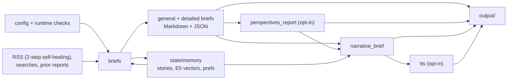
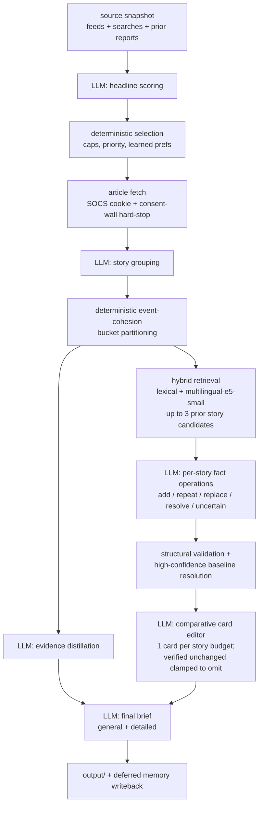

# MyDailyNews Architecture

Local-first news pipeline around an OpenAI-compatible `/v1/chat/completions` endpoint (default: `llama-server` at `http://127.0.0.1:8080/v1`). App owns retrieval, hybrid ranking, prompting, validation, local SQLite state, and output rendering; server owns model execution.

## Runtime Flow

```text
CLI / GUI -> config loader -> runtime checks -> NewsOrchestrator
  -> retrieval, ranking, story grouping, delta analysis, AI calls
  -> output/, state/memory/, .cache/mydailynews/
```

For managed `llama-server` mode (`manage_server=true`), see [llama_cpp_setup.md](llama_cpp_setup.md).

## Pipeline Overview



Default series: `briefs -> narrative_brief`. When `perspectives_report` is enabled, it runs before `narrative_brief` so verified claim cards feed narrative synthesis. `tts` runs last.

## Briefs Module



## Perspectives Module (`mydailynews/perspectives/`)

Orchestrated by [`mydailynews/pipeline/perspectives_report.py`](../mydailynews/pipeline/perspectives_report.py) across five focused modules:

1. **Inputs & Planning (`planning.py`)**: Collects same-day stories/claims from briefs; batches up to 4 stories per planner call (`PERSPECTIVES_PLANNER_SCHEMA`) to produce canonical queries, anchor groups, story loci, target country/region tags, and claim verification targets.
2. **Global Coverage (`coverage.py`)**: Queries GDELT, Registry RSS (with 2-step self-healing), and optional GNews in parallel; filters by lexical/anchor relevance, deduplicates, selects diverse countries/sources, and fetches bounded article excerpts.
3. **Claim Verification & Synthesis (`synthesis.py`)**: Runs targeted verification queries (DDG + news provider) and 1 verifier LLM call per selected claim (`PERSPECTIVES_VERIFIER_SCHEMA`), followed by 1 claim-led synthesis call per story (`PERSPECTIVES_CLAIM_SYNTHESIS_SCHEMA`).
4. **Schemas & Rendering (`schemas.py`, `rendering.py`)**: Validates JSON contracts and writes `YYYY-MM-DD_perspectives_report.{md,json}`.

## AI Roles & Storage Boundaries

- **AI Clients**: `summary_ai_client` (headline scoring, grouping, perspectives), `analysis_ai_client` (evidence, fact operations, card editor), `final_ai_client` (structured and narrative briefs).
- **State**:
  - `output/`: generated Markdown, JSON, WAV, diagnostics.
  - `state/memory/memory.sqlite3`: durable `StoryRecord`s, `SourceFact`s, coverage history, feedback, and E5 embeddings (`learned_preferences.json` stays human-editable).
  - `.cache/mydailynews/cache.sqlite3`: HTTP, article text (consent-wall scrubbed), and AI synthesis cache.

## Entrypoints

- [`main.py`](../main.py): CLI runner.
- [`gui.py`](../gui.py): local web UI server.
- [`tools/autoconfig.py`](../tools/autoconfig.py): hardware detection and `config.recommended.json` generator.
- [`tools/run_story_retrieval_diagnostics.py`](../tools/run_story_retrieval_diagnostics.py): 75-pair blind retrieval benchmark (`Recall@1 = 0.9333`, `Recall@3 = 0.9867`).
